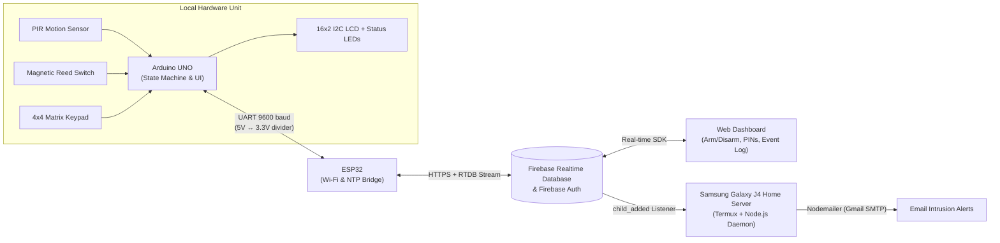
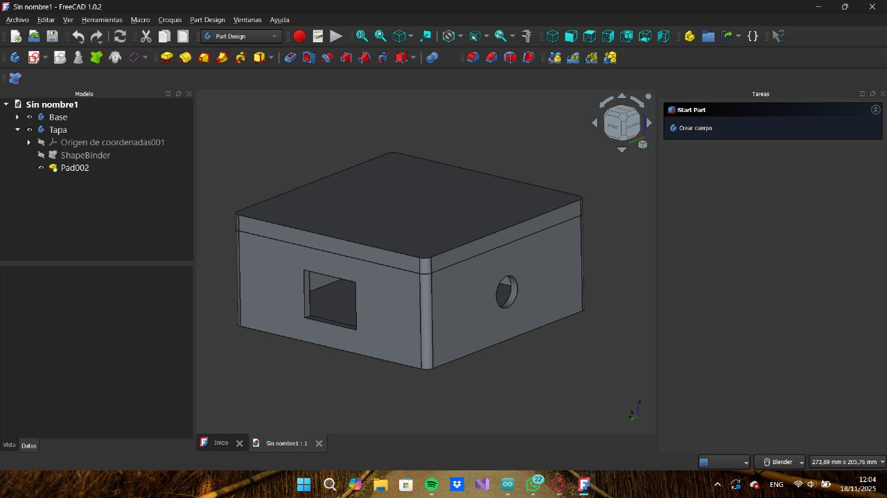
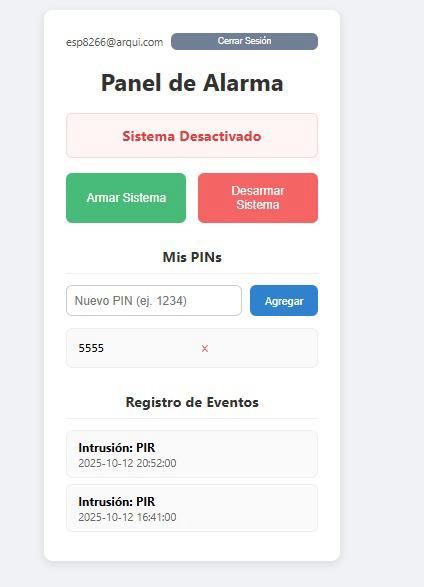
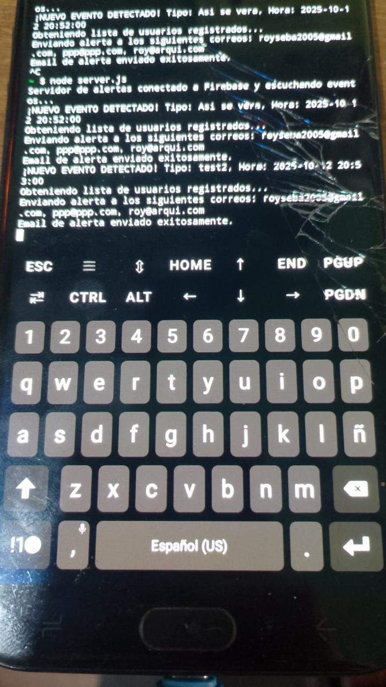

# Segurino — IoT Home Alarm System

**Segurino** is a full-stack IoT home security alarm system built around an **Arduino UNO**, an **ESP32**, **Firebase Realtime Database**, a **real-time Web Control Dashboard**, and a **self-hosted Node.js email alert daemon** running on a repurposed **Samsung Galaxy J4** home server (via Termux).

Originally developed as a college project for the **"Arquitectura de las Computadoras"** (Computer Architecture) subject.

---

## Table of Contents

- [System Architecture](#system-architecture)
- [Demo & Media](#demo--media)
- [Key Features](#key-features)
- [Repository Structure](#repository-structure)
- [Hardware & Pinout](#hardware--pinout)
- [Communication Protocols & Database Schema](#communication-protocols--database-schema)
- [Setup & Installation](#setup--installation)
- [Running Tests](#running-tests)

---

## System Architecture



### How It Works

1. **Sensor Monitoring & Entry Delay (Arduino UNO):** While armed, the Arduino UNO monitors a PIR motion sensor and a magnetic reed switch. When triggered, it enters a **15-second pre-alarm grace period** with a live LCD countdown and blinking red status LED, allowing a user to disarm using the 4×4 keypad.
2. **Cloud Bridge (ESP32):** Communicates with the Arduino UNO over UART (`Serial2`), validates entered PINs against Firebase `/pins`, keeps `/systemStatus/status` synchronized in both directions, and logs confirmed intrusions to `/events` with UTC NTP timestamps.
3. **Web Control Panel:** Authenticated users can remotely arm/disarm the alarm, create or delete their personal 4–8 digit keypad PINs, monitor live intrusion logs, and hear an instant browser alert tone on new events.
4. **Home Server Daemon (Samsung Galaxy J4):** A lightweight Node.js service running in Termux watches `/events` from startup onward and dispatches HTML email alerts via Gmail SMTP to all active, non-excluded registered users.

---

## Demo & Media

> **Note:** The photos and demo video below were captured during the initial Spanish-language hardware prototype. The codebase, UI, and documentation in this repository have since been refactored and translated into English.

### Hardware Prototype Demo (Video)

<video src="media/WorkingVideo.mp4" controls width="520">
  Your browser/viewer does not support embedded video playback.
</video>

- **Direct link:** [Watch the Hardware Demo Video (`media/WorkingVideo.mp4`)](media/WorkingVideo.mp4) — demonstrates the 3D-printed enclosure, 16×2 LCD, 4×4 keypad, status LEDs, and PIR motion sensor.

### Project Gallery

| 3D-Printed Enclosure (FreeCAD) | Web Control Dashboard |
| :---: | :---: |
|  |  |
| *Custom base and lid enclosure designed in FreeCAD for the LCD, keypad, and sensors.* | *Web interface for arming/disarming, managing PINs, and viewing intrusion history.* |

#### Self-Hosted Alert Daemon on Samsung Galaxy J4 (Termux)



*Repurposed Samsung Galaxy J4 running `node server.js` in Termux, listening to Firebase Realtime Database and dispatching Gmail intrusion alerts.*

---

## Key Features

- **Non-Blocking 4-State Alarm Controller:** `DISARMED` → `ARMED` → `PRE_ALARM` (15s countdown) → `ALARM_TRIGGERED` (prevents duplicate event flooding if a door stays open).
- **Bidirectional State Sync:** Arming or disarming via either the physical keypad or the web dashboard keeps both the hardware and Firebase Realtime Database synchronized.
- **Dedicated Debug & Hardware UARTs:** ESP32 isolates USB debug output (`Serial` at 115200 baud) from Arduino UART traffic (`Serial2` at 9600 baud), preventing log messages from colliding with control commands.
- **Per-User Keypad PIN Management:** Multi-user Firebase Authentication with masked/revealable PINs, optional labels, and duplicate checks.
- **XSS-Safe & Dependency-Free Alert Tone:** Web UI uses safe DOM text nodes (`textContent`) and a synthesized Web Audio API alert chime instead of external hotlinked audio.
- **Timezone-Agnostic Daemon Filtering:** Uses UTC Unix `epoch` seconds so the Samsung J4 server only alerts on new intrusions occurring after daemon startup, regardless of device timezone.

---

## Repository Structure

```text
segurino/
├── README.md
├── .gitignore
├── firebase/
│   └── database.rules.json                 # Firebase RTDB security & validation rules
├── firmware/
│   ├── arduino_uno/
│   │   └── segurino_arduino/
│   │       └── segurino_arduino.ino        # Arduino UNO controller firmware
│   └── esp32/
│       └── segurino_esp32/
│           ├── config.example.h            # Template for Wi-Fi & Firebase credentials
│           └── segurino_esp32.ino          # ESP32 Wi-Fi, NTP & Firebase bridge
├── web/
│   ├── index.html                          # Web control panel markup
│   ├── css/
│   │   └── styles.css                      # Responsive dashboard styles
│   └── js/
│       ├── firebase-config.example.js      # Template for Firebase Web SDK config
│       └── app.js                          # Dashboard auth, RTDB listeners & UI logic
├── daemon/
│   ├── package.json                        # Node.js daemon dependencies & test script
│   ├── .env.example                        # Environment variables template
│   ├── server.js                           # Firebase listener & Nodemailer dispatcher
│   ├── lib/
│   │   └── alertHelpers.js                 # Pure helper functions for filtering & emails
│   └── test/
│       └── alertHelpers.test.js            # Unit tests (node:test)
└── media/
    ├── 3dmodel.jpeg
    ├── daemonWorkingOnJ4homeserver.jpeg
    ├── webpage.jpeg
    └── WorkingVideo.mp4
```

---

## Hardware & Pinout

### Arduino UNO Connections

| Component | Arduino UNO Pin | Mode / Notes |
| :--- | :--- | :--- |
| **4×4 Keypad Rows** | `D9, D8, D7, D6` | Matrix rows 1–4 |
| **4×4 Keypad Columns** | `D5, D4, D3, D2` | Matrix columns 1–4 |
| **Green Status LED** | `D10` | `OUTPUT` — ON when Armed |
| **Magnetic Reed Switch** | `D11` | `INPUT_PULLUP` — Triggers `PRE_ALARM` when `LOW` |
| **PIR Motion Sensor** | `D12` | `INPUT` — Triggers `PRE_ALARM` when `HIGH` |
| **Red Status LED** | `D13` | `OUTPUT` — ON when Disarmed, blinks during alarm |
| **16×2 I2C LCD** | `A4 (SDA), A5 (SCL)` | Controlled via `Adafruit_LiquidCrystal(0)` |

### Arduino UNO ↔ ESP32 UART Wiring

| Arduino UNO | ESP32 | Notes |
| :--- | :--- | :--- |
| `TX (D1)` | `RX2 (GPIO16)` | **Use a 5V → 3.3V voltage divider** (e.g., 1 kΩ + 2 kΩ) to protect the ESP32 pin |
| `RX (D0)` | `TX2 (GPIO17)` | 3.3V logic is recognized as `HIGH` by Arduino UNO |
| `GND` | `GND` | Common ground required |

> **Tip:** Disconnect `D0`/`D1` while flashing new sketches to the Arduino UNO over USB.

---

## Communication Protocols & Database Schema

### UART Protocol (`9600` baud, `\n`-terminated)

- **Arduino → ESP32**
  - `PIN:<digits>` — Request Firebase validation for an entered keypad PIN
  - `EVENT:<PIR|REED>` — Report a confirmed intrusion after the 15s grace period expires
  - `STATE:<ARMED|DISARMED>` — Notify Firebase when state changes via local keypad
  - `SYNC` — Request current cloud state on Arduino boot
- **ESP32 → Arduino**
  - `PIN_OK` / `PIN_FAIL` — Result of keypad PIN verification
  - `CMD:ARM` / `CMD:DISARM` — Remote command triggered from Firebase `/systemStatus/status`

### Firebase Realtime Database Structure

```json
{
  "systemStatus": {
    "status": "DISARMED"
  },
  "pins": {
    "-Nabc123": {
      "value": "1234",
      "owner": "firebase-user-uid",
      "label": "Front Door",
      "createdAt": "2026-11-15T20:00:00.000Z"
    }
  },
  "events": {
    "-Nxyz789": {
      "type": "PIR",
      "timestamp": "2026-11-15T20:05:12Z",
      "epoch": 1794773112
    }
  }
}
```

---

## Setup & Installation

### 1. Firebase Project Setup

1. Create a Firebase project and enable **Authentication (Email/Password)** and **Realtime Database**.
2. Create a dedicated device user account in Firebase Auth for the ESP32 (e.g., `esp32@yourdomain.com`).
3. Deploy the security rules from [`firebase/database.rules.json`](firebase/database.rules.json) in the Firebase Console under **Realtime Database → Rules**.
4. Under **Project Settings → Service Accounts**, generate a private key JSON file for the Node.js daemon.

### 2. Arduino UNO Firmware

1. Open [`firmware/arduino_uno/segurino_arduino/segurino_arduino.ino`](firmware/arduino_uno/segurino_arduino/segurino_arduino.ino) in the Arduino IDE.
2. Install the required libraries via Library Manager:
   - `Adafruit LiquidCrystal`
   - `Keypad` (by Mark Stanley, Alexander Brevig)
3. Select **Arduino UNO** and upload the sketch.

### 3. ESP32 Firmware

1. Copy [`firmware/esp32/segurino_esp32/config.example.h`](firmware/esp32/segurino_esp32/config.example.h) to `firmware/esp32/segurino_esp32/config.h`:
   ```bash
   cp firmware/esp32/segurino_esp32/config.example.h firmware/esp32/segurino_esp32/config.h
   ```
2. Fill in your Wi-Fi SSID/password, Firebase API key, project ID, and ESP32 device credentials.
3. Install the required libraries in Arduino IDE:
   - `Firebase ESP32 Client` (by Mobizt)
   - `NTPClient` (by Fabrice Weinberg)
4. Open [`firmware/esp32/segurino_esp32/segurino_esp32.ino`](firmware/esp32/segurino_esp32/segurino_esp32.ino), select your ESP32 board, and upload.

### 4. Web Control Dashboard

1. Copy [`web/js/firebase-config.example.js`](web/js/firebase-config.example.js) to `web/js/firebase-config.js`:
   ```bash
   cp web/js/firebase-config.example.js web/js/firebase-config.js
   ```
2. Paste your Firebase Web App configuration object into `web/js/firebase-config.js`.
3. Serve the `web/` folder using any static file server (or Firebase Hosting):
   ```bash
   npx serve web
   ```

### 5. Node.js Alert Daemon (Samsung Galaxy J4 / Linux)

On your home server (or Android device running **Termux** with `pkg install nodejs`):

1. Install dependencies:
   ```bash
   cd daemon
   npm install
   ```
2. Place your Firebase Admin private key at `daemon/serviceAccountKey.json`.
3. Create `daemon/.env` from the example template:
   ```bash
   cp .env.example .env
   ```
   Configure `FIREBASE_DATABASE_URL`, `GMAIL_USER`, a **Google App Password** (`GMAIL_APP_PASSWORD`), and `EXCLUDED_EMAILS` (including the ESP32 device account so it doesn't receive alert emails).
4. Start the daemon:
   ```bash
   npm start
   ```
   *(Optional)* Use `pm2` (`pm2 start server.js --name segurino-alerts`) to keep the daemon running persistently across restarts.

---

## Running Tests

The Node.js alert daemon includes unit tests using Node's built-in test runner (`node --test`):

```bash
cd daemon
npm test
```
